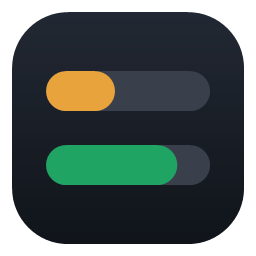
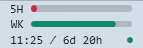

<div align="center">

# Codex Quota Chip

Windows 任务栏上的 Codex 额度小浮窗：一眼看到还剩多少，右键看每个账号。

[English](README.en.md) | **简体中文** ・ [更新记录](CHANGELOG.md)



</div>

## 有什么用

**两个核心功能：**

1. **实时查看当前账号的额度** —— 任务栏上常驻一条浮窗，5 小时 / 周额度还剩多少、什么时候恢复，一眼看清；
2. **查看多账号额度** —— 右键面板列出这台机器上用过的每个账号最后读到的数值，标出当前登录的是哪一个。

**其他功能**：

- **额度恢复提醒**：额度重置时弹 Windows 通知；
- **重置次数展示**：账号还剩几次手动重置额度，用票券图标标出来（含每张的到期日）；
- **单实例运行**：常驻任务栏、不占窗口、不进 Alt+Tab、不抢焦点；
- **只读、不存凭据**。

## 长什么样

 &nbsp;&nbsp;&nbsp;&nbsp; 

常驻任务栏的一小块，三行：5小时额度条、周额度条、以及「5H 重置时刻 / 周重置倒计时 + 状态灯」。
额度条的颜色随剩余量变（绿 / 黄 / 红），右下角那个小圆点是状态灯（正常 / 读取中或数据变旧 / 还没读到 / 读取失败）。

浮窗默认铺一层深色圆角底图（左图），也可以关掉、直接贴在任务栏上（右图），配色跟着任务栏明暗走。

鼠标操作：**左键刷新一次，右键打开面板**。

右键面板：


显示每个用过的账号额度信息：名字（当前登录的那个标 `【当前】`）、还剩几次手动重置额度的票券、以及 5H / WK
两行数字。名字前面的圆点是**这一路数据还在不在刷新** —— 绿 = 还在刷新，灰 = 停了（比如账号已退出，或者
令牌失效那段时间）。每个账号的重置时刻和倒计时都按服务端给的时间渲染；窗口刚重置、或者重置时刻已过，
那一行显示 `已重置`，进度条画成满绿。

## 额度是怎么读到的

程序启动本机 Codex 自带的命令行：

```
codex.exe app-server --listen stdio://
```

然后走 JSON-RPC 调 `account/rateLimits/read`，按返回里的 `windowDurationMins` 区分窗口
（约 300 分钟 → 5H，约 10080 分钟 → WK），而不是假定 `primary`/`secondary` 谁是谁。
同一份返回里的 `rateLimitResetCredits` 就是那个账号还剩几次重置额度，面板上的票券图标来自它。
每次读取起一个进程、问完就结束进程（一次读取约 1.5 秒）。

- **只读**：不写、不改 Codex 的任何文件；`auth.json` 只读，用来知道当前登录的是哪个账号。
- **不存凭据**：账号记录里只有账号 ID / 邮箱 / 百分比 / 时间，没有任何 token。
- 状态文件在 `%LOCALAPPDATA%\CodexQuotaChip\`。

### 重置提醒是怎么判断的

- **正在读的账号**：不靠本地时钟 —— 窗口重置时服务端会把 `resetsAt` 往后推将近一整个窗口，所以
  「重置时间往后跳了至少 70% 的窗口长度」才算翻篇；重启、休眠、程序没开都算得准，同一次不会重复提醒。
- **没在读的账号**：它的额度没人消耗，最后一次读数里的重置时间一过就是恢复了 —— 到点提醒一次，
  通知小字写明"该账号未登录，以最后一次刷新数据推算"。

通知走系统 toast（进通知中心、遵守「勿扰 / 专注助手」）：程序给自己登记一个 app id，并让进程本身也用
同一个 app id —— 未打包程序不这么做，系统会收下通知再悄悄丢掉；发出去之后还会对账，没进通知中心就
退回通知区域气泡。

## 安装

绿色包，不需要管理员权限。解压 zip 后在同目录运行：

```powershell
pwsh -File .\install.ps1            # 装到 %LOCALAPPDATA%\Programs\CodexQuotaChip
pwsh -File .\install.ps1 -Autostart # 顺便写开机自启
```

也可以直接双击 zip 里的 `CodexQuotaChip.exe`（自包含，不需要预装 .NET）。开机自启也能在面板里开关；
`uninstall.ps1` 去掉自启项和安装目录（加 `-Purge` 连状态文件一起删）。

用 npm 装也行 —— 那个包只是个外壳：安装时去对应版本的 Release 下载 zip，校验 sha256 通过才解压：

```sh
npm install -g codex-quota-chip
codex-quota-chip --check
```

需要：Windows 10/11 x64；已安装并登录 Windows 桌面版 Codex（程序从
`%LOCALAPPDATA%\OpenAI\Codex\bin\*\codex.exe` 或 `PATH` 里找 `codex.exe`）。

## 设置文件

`%LOCALAPPDATA%\CodexQuotaChip\settings.json`，各项含义和默认值见 [`settings.example.json`](settings.example.json)；
面板上改的设置也写在这里。用环境变量 `CODEX_QUOTA_CHIP_HOME` 或命令行 `--home` 可以换状态目录。

## 命令行

```
CodexQuotaChip.exe --check      # 打印状态目录、codex 路径、将要停靠的位置（含真实宽度），不起界面
CodexQuotaChip.exe --once       # 读一次并打印 JSON，不起界面
CodexQuotaChip.exe --notify-test # 立刻弹一条测试通知（不用等真的重置）
  --codex-home <path>           # 换 Codex home（默认 %CODEX_HOME% 或 ~/.codex）
  --codex-exe <path>            # 显式指定 codex.exe
  --refresh-seconds <n>         # 覆盖取数间隔
  --home <path>                 # 换状态目录
```

## 从源码构建

需要 .NET 8 SDK：

```powershell
dotnet build .\src\CodexQuotaChip\CodexQuotaChip.csproj -c Release
dotnet run   --project .\tests\CodexQuotaChip.Tests          # 自检
pwsh -File .\tools\make-icon.ps1                             # 重新生成 app.ico 和 docs\icon.png
pwsh -File .\build-publish.ps1 -Version 0.2.13               # 出 publish\ 下的 zip
```

图标不是丢一个二进制在仓库里就算完：`tools/make-icon.ps1` 用深色圆角方块加两条额度条画出来（含
16/24/32/48/64/128/256 七个尺寸），README 的头图 `docs/icon.png` 也由它一并生成。

自检覆盖的都是有规则可讲的部分：解析与窗口分类、读数格式化、账号排序、浮窗停靠、额度条几何、
浮窗宽度测量、重置条满绿、链路状态灯的新鲜度、时间到了只报一次、点外关闭规则、设置文件的容错、
codex.exe 路径失效后重解析、账号记录文件。

## 已知边界

- `codex app-server` 不是公开承诺稳定的接口，桌面版 Codex 更新后方法名/字段可能变；读不到时日志里会写
  原因（`%LOCALAPPDATA%\CodexQuotaChip\logs\app.log`），浮窗保留上一次有效读数、状态灯转黄/红。
- 程序只读**当前登录账号**的额度。已退出账号的数值停在最后一次被读到的时候（圆点变灰），它的倒计时是
  本地按记录里的重置时间渲染的，时间一过显示 `已重置` 并通知一次 —— 那是推算，不是又读了一次服务端。
  想让它持续刷新就得存每个账号的凭据，本程序刻意不存。
- 读数只适合日常参考，不是计费依据。

## 许可证

MIT，见 `LICENSE`。本项目不是 OpenAI 官方项目，与 OpenAI 无关联。
